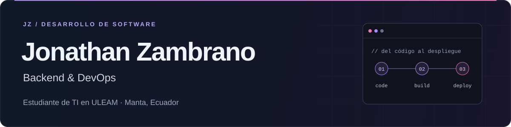

[LinkedIn](https://www.linkedin.com/in/jonathan-zambrano-425a6b402) · [Correo](mailto:jonathanz1504@gmail.com) · [Ver repositorios](https://github.com/jonathanZM15?tab=repositories)

Soy estudiante de **Tecnologías de la Información en la ULEAM**, desde **Manta, Ecuador**. Desarrollo aplicaciones web, móviles y de escritorio, con interés en **backend, automatización y DevOps**.

Me gusta construir herramientas útiles y aprender cómo llevarlas del código al despliegue. Estos son algunos de los proyectos en los que he trabajado.

## Proyectos destacados

### 01 · Facturación y firma electrónica

**Proyecto en equipo · frontend y backend.** Sistema de comprobantes electrónicos con gestión de usuarios, clientes e inventario.

**Mis aportes:** generación y firma de XML para el SRI, procesamiento asíncrono de comprobantes, protección de rutas y funcionalidades de clientes e inventario.

`PHP` `Laravel` `React` `TypeScript` `API REST`

[Ver backend](https://github.com/jonathanZM15/FacturaElectronica-Backend) · [Ver frontend](https://github.com/jonathanZM15/FacturaElectronica-Frontend)

### 02 · Youtify — Audio y video

**Aplicación de escritorio para Windows.** Descarga de audio MP3 y video MP4, con playlists, carátulas y una cola que conserva los pendientes entre sesiones.

**Mi trabajo:** mejoras de interfaz y cola, actualizaciones automáticas, optimización de recursos y automatización de pruebas y compilación del instalador con GitHub Actions.

`Python` `CustomTkinter` `yt-dlp` `FFmpeg` `GitHub Actions`

[Ver código](https://github.com/jonathanZM15/YOUTIFY-MUSICA-VIDEO) · [Descargar / Releases](https://github.com/jonathanZM15/YOUTIFY-MUSICA-VIDEO/releases)

### 03 · TAMATS

**Proyecto en equipo · Android.** Aplicación social con perfiles, matches y chat.

**Mis aportes:** diseño de pantallas de inicio de sesión, registro y splash, mejoras de formularios y ajustes en el envío de correos.

`Kotlin` `Android` `Firebase` `Firestore`

[Ver código](https://github.com/jonathanZM15/PROYECTO-TAMATS)

## Tecnologías

| Área | Herramientas |
| :--- | :--- |
| **Backend** | PHP, Laravel, Python |
| **Web** | JavaScript, TypeScript, React |
| **Móvil** | Kotlin, Android, Firebase |
| **Herramientas e infraestructura** | Git, GitHub Actions, Docker, Linux |

## En lo que estoy profundizando

- Orquestación de contenedores con **Kubernetes**.
- Pipelines de **CI/CD** y automatización de despliegues.
- Diseño de **microservicios** e **infraestructura en la nube**.

---

Fuera del código: salsa de fondo, Valorant, Minecraft y algún directo en [Kick](https://kick.com/jonathan1504).

**¿Construimos algo?** Me interesa colaborar en proyectos de backend y DevOps. [Hablemos por LinkedIn](https://www.linkedin.com/in/jonathan-zambrano-425a6b402) o por [correo](mailto:jonathanz1504@gmail.com).
